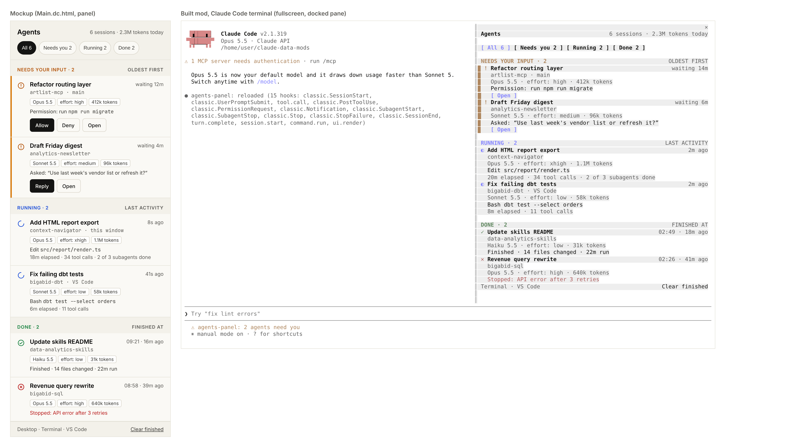

<div align="center">

# 🤖 Agents panel

**Every Claude Code session you have running, in one panel beside the chat.**

See which sessions need you, which are working and which are done, with model, effort, tokens and what each one did last.



</div>

---

## ⚡ Install

In Claude Code, run:

```
/plugin install agents-panel --marketplace nimrodfisher/claude-data-mods
```

1. Answer **`y`** to add the marketplace.
2. Pick the **user** scope. This matters: each session reports its own status, so the mod has to load in every session.
3. Restart Claude Code. The panel opens beside the chat. Run **`/agents-panel`** to reopen it.

From your shell instead:

```bash
claude plugin install agents-panel@claude-data-mods --scope user
```

---

## What it shows

| Status | When |
| --- | --- |
| **Needs input** | A permission prompt, a question (`AskUserQuestion`), or a turn that ended on a question |
| **Running** | A prompt was sent or a tool is running |
| **Done** | The turn finished. Closed sessions stay here for 1 hour, then hide |
| **Error** | The turn stopped on an API error, or a run had no activity for 10 minutes (shown as "stale") |

- **List:** sections in the order needs input (oldest wait first), running (latest activity first), done (latest first). Filter chips: All, Needs you, Running, Done.
- **Row:** status icon (shape plus color), title, `repo · branch`, model, effort and token pills, last activity, and the time.
- **Detail:** click a title to see the prompt, the pending request, tokens (input/output, cache read/write), context used, tool calls, subagents, files changed and the last 20 events.
- **Status line:** "2 agents need you" while other sessions are waiting.
- **Clear finished** removes done and error sessions.

## How it works

Each session's copy of the mod listens to its own hook events and writes `~/.claude/agents-status/<session_id>.json` (or under `CLAUDE_CONFIG_DIR`). The panel reads that folder every 2 seconds. Nothing is added to `settings.json`, and the hooks never block Claude: every error is swallowed.

Tokens are summed from each turn's usage, and effort comes from the hook input.

## Limits

- **Open** copies `cd <dir> && claude --resume <id>` to the clipboard. The mod API can't focus another session's window.
- **Allow and Deny aren't there.** The mod API can't answer another session's permission prompt.
- Only sessions with the mod loaded show up. A user-scope install loads in the terminal, the desktop app's Code tab and VS Code. It has only been tested in the terminal.
- The mod API has no atomic rename, so the panel can catch a file halfway through a write. When it does, it keeps the last good read of that file.

## Develop

```bash
claude plugin validate mods/agents-panel
claude plugin test mods/agents-panel
claude --plugin-dir mods/agents-panel   # the mod hot-reloads as you edit
```
